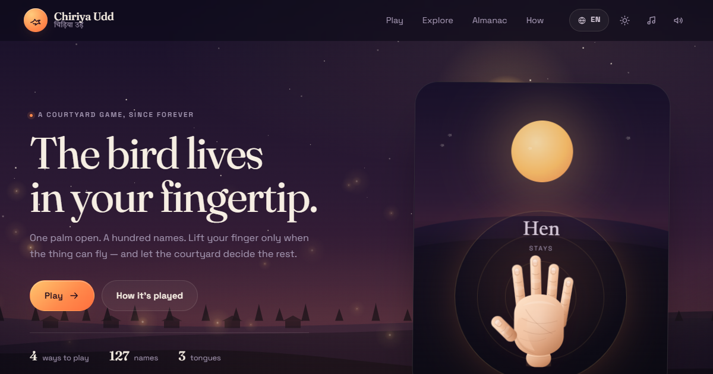
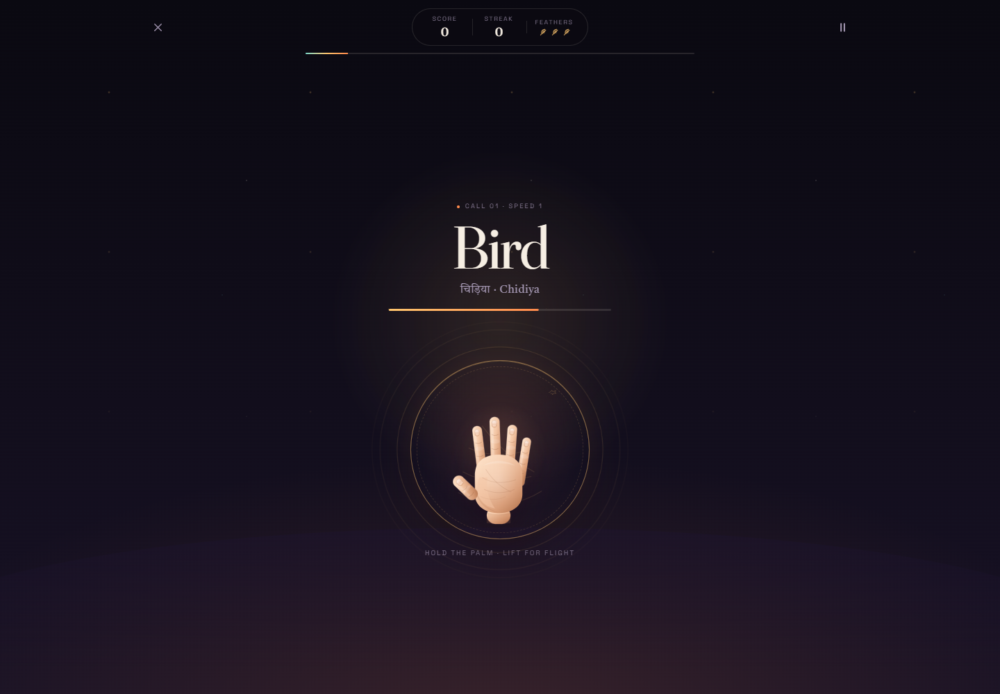
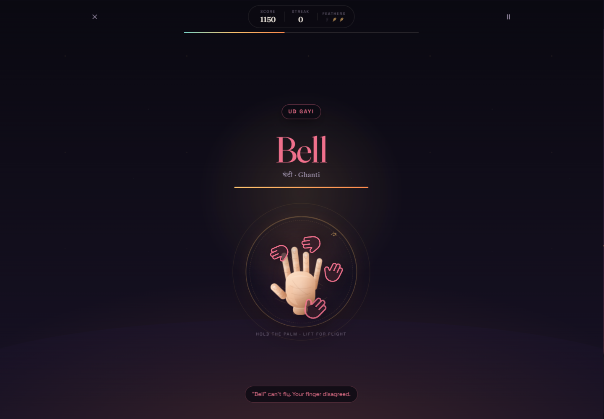
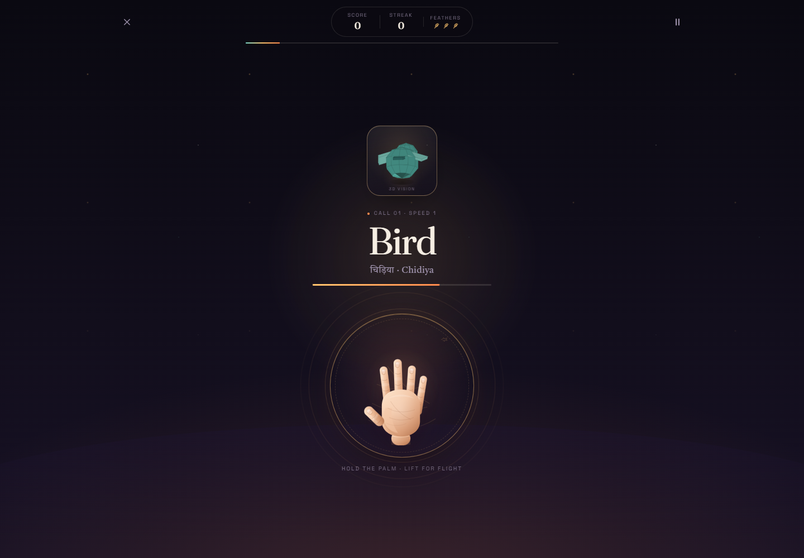
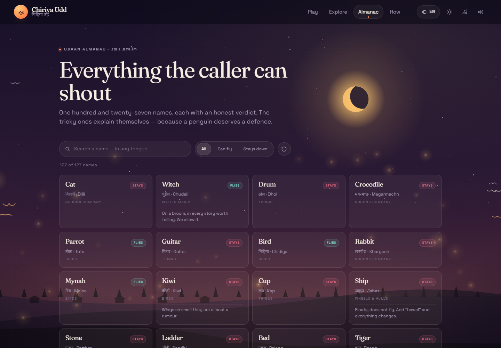
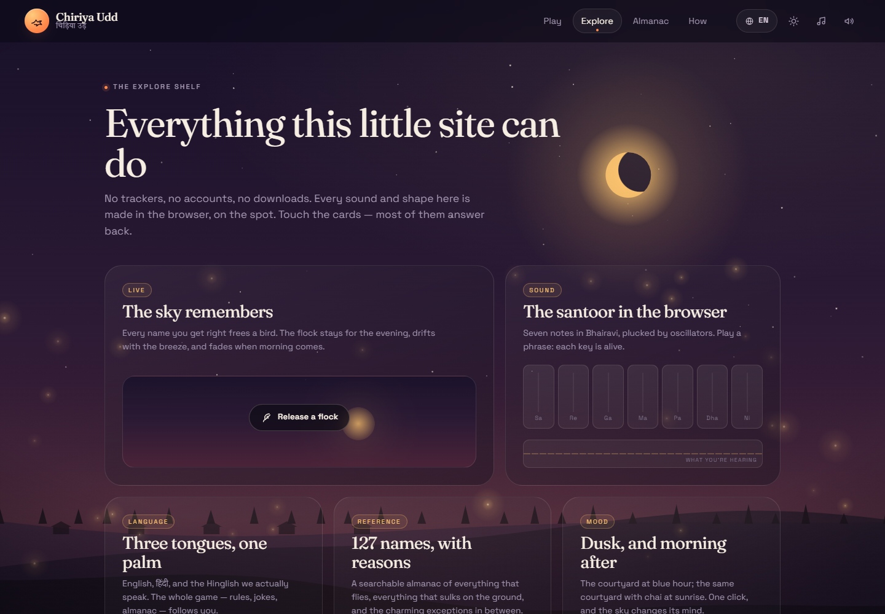
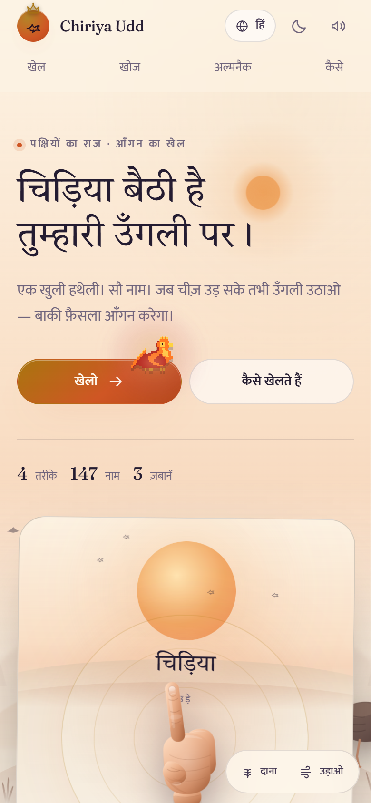

<div align="center">

# Chiriya Udd · चिड़िया उड़

**The bird lives in your fingertip.**

A courtyard game of flying names. Rest a finger on the palm, and lift it only when the called name can fly.

[**▶ Play the game**](https://ajeet-iitk.github.io/ChiriyaUdd/) &nbsp;·&nbsp; [How to play](#how-to-play) &nbsp;·&nbsp; [What's inside](#whats-inside)

[](https://ajeet-iitk.github.io/ChiriyaUdd/)

`127 names` · `4 modes` · `3 languages` · `2 themes` · `0 accounts` · `0 build steps`

</div>

---

## The game

Every evening, in courtyards across South Asia, someone opens a palm and everyone else rests an index finger on it. A caller begins naming things. **Chidiya.** The fingers rise like a startled flock. **Kursi.** Nothing moves — a chair cannot fly, and everyone knows it.

When the caller gets quicker and meaner, the palm becomes a lie detector. The first person to lift for a chair — or to stay for a parrot — loses, and the circle exacts its affectionate revenge.

**Chiriya Udd** rebuilds that game for the browser: one palm, four modes, 127 names in English, Hindi and Hinglish, a dusk courtyard that remembers every bird you free, and a score played live by a browser santoor.

> A game about attention, and about trusting your own hand. Also, mostly, an excuse to laugh at your friends.

## How to play

| Step | What you do |
| --- | --- |
| **1** | **Press and hold** the palm — mouse, thumb, or the `Space` bar. This is your bird, perched. |
| **2** | **Listen for the call.** A name appears with a shrinking meter and a second name in another tongue. |
| **3** | **Lift** before the meter empties if it can fly. **Keep holding** if it cannot. |
| **4** | **Release and press again** between names. The courtyard waits for your finger to return. |

The category is deliberately hidden while you play. You have to trust your first thought — that is the game.

### Four temperatures

| Mode | Rules |
| --- | --- |
| **Baithak** | The full courtyard. Three feathers; a wrong lift or a missed flyer costs one. Calls get faster as you get better. |
| **Bijli** | 45 seconds of lightning. No feathers, but a wrong answer costs 2 seconds. |
| **Dheere** | Zen. No lives, no clock, longer windows, and a quiet fly/stay hint. For learning the almanac. |
| **Maya** | Three feathers, and a small 3D vision floating beside every name. Usually it matches. Sometimes it is a decoy — a picture of something else entirely — and trusting the picture instead of the name costs a feather. |

Tap **Play** anywhere and the four modes line up in a picker; you can switch between runs without leaving the courtyard.

Scores, bests, theme, language, and volume all live in `localStorage`. No cookies, no accounts, no network calls after the page loads.

## Screenshots

| Home — dusk | Home — daylight |
| --- | --- |
|  |  |

| The call | A friendly thwack |
| --- | --- |
|  |  |

| The mode picker | Maya's 3D vision |
| --- | --- |
|  |  |

| The almanac | The explore shelf |
| --- | --- |
|  |  |

| End of a baithak | Hindi, on a phone |
| --- | --- |
|  |  |

More: [the intro sheet](docs/screenshots/play-intro.png), [the how-it's-played page](docs/screenshots/how.png), [the flock release demo](docs/screenshots/explore-flock.png), [the 3D vision demo](docs/screenshots/explore-vision.png), [Hindi home](docs/screenshots/home-hindi.png), [mobile home](docs/screenshots/mobile-home.png), [mobile picker](docs/screenshots/mobile-picker.png).

## What's inside

The [Explore shelf](https://ajeet-iitk.github.io/ChiriyaUdd/#explore) is the honest inventory — every creative thing the site can do, with a live demo attached.

- **A courtyard that remembers.** A canvas dusk with drifting stars, hills, a treeline, fireflies, and a bird flock. Every flyer you call correctly frees another bird; the flock drifts with the breeze and grows for the whole session. Day and night now *melt* into each other: the sky, sun, hills, stars and crescent moon crossfade over about a second instead of snapping.
- **A hand with five fingers.** The palm is a hand-drawn SVG hand — skin gradients, nails, knuckles, palm lines and a thumb — and every finger lifts, presses and slips on its own. Miss, and the fingers flinch one after another.
- **3D visions, no libraries.** Maya floats a flat-shaded low-poly model beside the name, hand-built from 50+ procedural meshes and turned on a canvas. Roughly a third of them are deliberate decoys.
- **A score with no audio files.** Tanpura drone, santoor plucks and tabla ticks are synthesised in the Web Audio API, tuned to **D Bhairavi**. Seven playable santoor keys, a live visualiser, and separate music/SFX controllers.
- **127 names, with reasons.** 42 fly and 85 stay. The tricky ones explain themselves: a penguin swims, a dodo never flew, a phone flies only when you are angry. Search in any of the three tongues, filter by flies/stays, or shuffle the deck.
- **Three tongues.** English, Hindi, and the Hinglish people actually speak — every rule, joke, toast, and excuse translated, Devanagari set in Tiro Devanagari Hindi, Hinglish in the same relaxed voice as the English.
- **Dusk and morning.** A full light/dark design system. The courtyard at blue hour, the same courtyard with chai at sunrise. Your choice persists.
- **Gesture-first controls.** Pointer events with pointer-ID tracking (so a stray toolbar tap cannot count as a lift), touch support, and `Space`/`Esc`/`M` on the keyboard.
- **Feedback you can feel.** Verdict stamps (`Udd!` / `Ruk!` / `Sahi nazar!`), a score pop, feathers going grey, five friendly thwacks, a screen shake, a finger slip, a toast that explains the miss or the decoy, and birds flying out of the palm.
- **An almanac that teaches.** Every miss at the end of a run shows the name and its reason, so the next baithak is smarter.
- **Small-screen first.** Safe-area insets, no horizontal scroll at 360 px, tap targets above 44 px, and a play layout that fits a phone in portrait.
- **Considerate by default.** ARIA live regions for the call and toast, visible focus states, keyboard play, `prefers-reduced-motion` support, and no sound until you ask for it.

## The almanac

| Verdict | Count | Examples |
| --- | --- | --- |
| **Flies** | 42 | bird, bat, kite, balloon, rocket, drone, fairy, Garuda, flying carpet, witch |
| **Stays** | 85 | chair, penguin, ostrich, kiwi, fish, submarine, ship, egg, phone, broom |

The full list is searchable at [`#almanac`](https://ajeet-iitk.github.io/ChiriyaUdd/#almanac). Judgment calls are documented in the data itself — a broom stays put, a witch's broom flies, a ship floats, a seaplane flies.

## Tech

No framework, no bundler, no dependencies. ES modules, hand-written CSS, a canvas scene, and the Web Audio API.

```
index.html               page shell, play layer, SVG sprite
css/style.css            full design system, play stage, responsive + motion rules
js/
  words.js               the 127-name almanac + bag shuffle
  i18n.js                English · Hindi · Hinglish strings
  audio.js               synthesised tanpura, santoor, tabla, FX
  scene.js               canvas sky, stars, fireflies, flock, day/night crossfade
  play.js                game state machine, scoring, overlays, Maya decoys
  hand.js                five-finger SVG hand + per-finger slip animation
  vision.js              flat-shaded 3D models and canvas renderer
  main.js                routing, themes, languages, explore demos, almanac
  store.js               localStorage settings + best scores
assets/                  favicon, app icons, social card
docs/screenshots/        the images in this README
```

### Run it locally

ES modules need a tiny HTTP server (opening `index.html` directly will not load the modules):

```bash
python -m http.server 8000
# or: npx serve .
```

Then open <http://localhost:8000/>.

### Deploy

The site is plain static files, so GitHub Pages serves it from the repository root. No workflow, no build:

**Settings → Pages → Source: Deploy from a branch → `main` / `(root)`.**

Live at **<https://ajeet-iitk.github.io/ChiriyaUdd/>**.

## Credits

Words, art, motion, and sound are hand-made for this project. Type is set in **Fraunces**, **Space Grotesk**, **Tiro Devanagari Hindi**, and **Mukta** from Google Fonts.

Built by [Ajeet](https://github.com/Ajeet-iitk). Released under the [MIT License](LICENSE).

<div align="center">

**चिड़िया उड़ · उड़ · उड़**

*Hold the palm. Trust the first thought. Let the courtyard decide the rest.*

</div>
