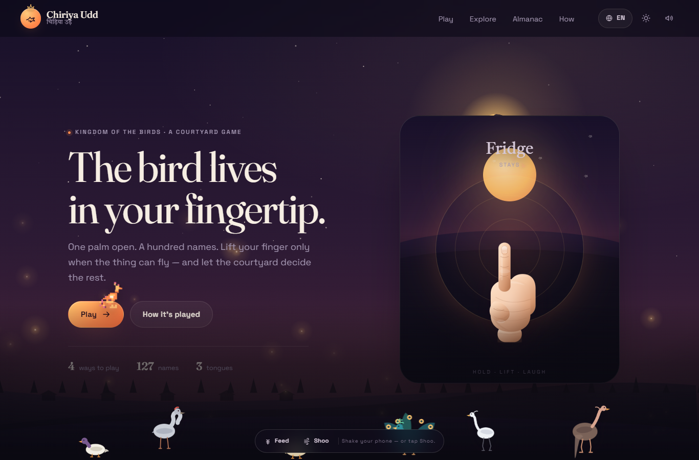
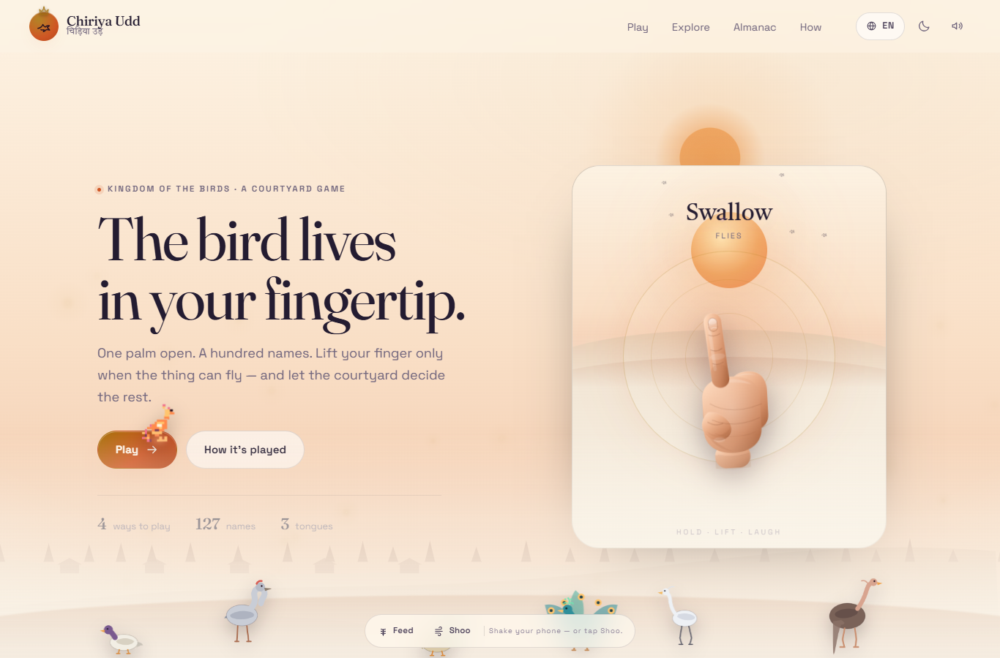
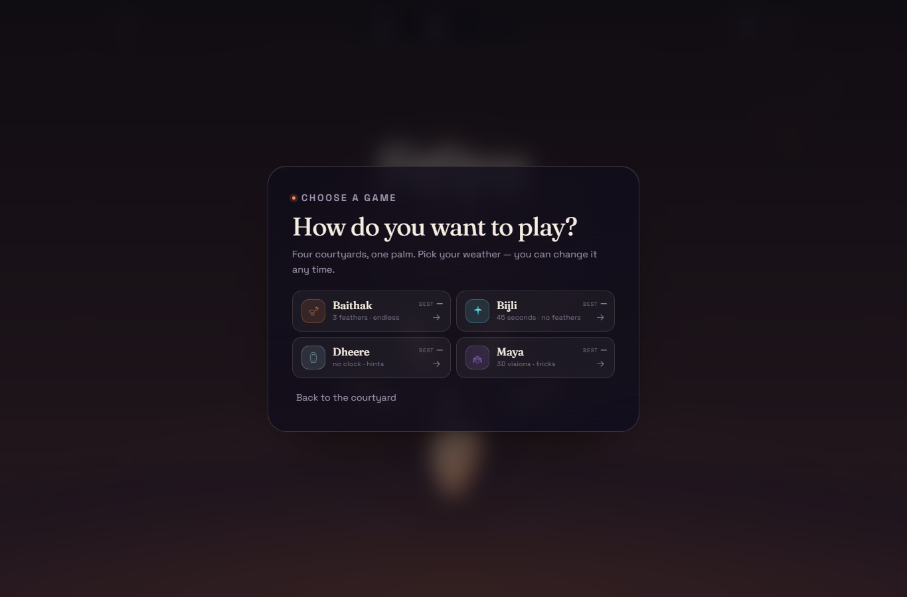
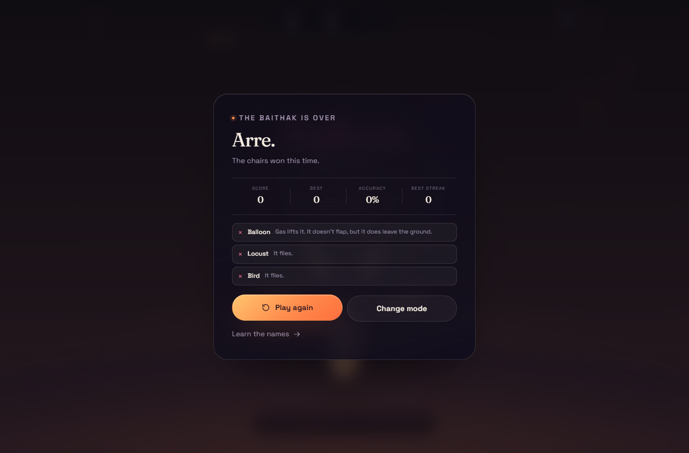

<div align="center">

# Chiriya Udd · चिड़िया उड़

**The bird lives in your fingertip.**

A courtyard game of flying names — now set in a **Kingdom of the Birds**. Your finger rests on the palm by itself; lift it only when the called name can fly.

[**▶ Play the game**](https://ajeet-iitk.github.io/ChiriyaUdd/) &nbsp;·&nbsp; [How to play](#how-to-play) &nbsp;·&nbsp; [What's inside](#whats-inside)

[](https://ajeet-iitk.github.io/ChiriyaUdd/)

`147 names` · `4 bird courts` · `3 languages` · `2 themes` · `0 accounts` · `0 build steps`

</div>

---

## The game

Every evening, in courtyards across South Asia, someone opens a palm and everyone else rests an index finger on it. A caller begins naming things. **Chidiya.** The fingers rise like a startled flock. **Kursi.** Nothing moves — a chair cannot fly, and everyone knows it.

When the caller gets quicker and meaner, the palm becomes a lie detector. The first person to lift for a chair — or to stay for a parrot — loses, and the circle exacts its affectionate revenge.

**Chiriya Udd** rebuilds that game for the browser: one palm, four bird courts, 147 names in English, Hindi and Hinglish, a dusk courtyard that remembers every bird you free, and a score played live by a browser santoor. The home meadow keeps a flock of its own, a phoenix burns and rises again above the Play button, and hummingbirds follow your cursor.

> A game about attention, and about trusting your own hand. Also, mostly, an excuse to laugh at your friends.

## How to play

| Step | What you do |
| --- | --- |
| **1** | **Rest your index finger on the palm.** It settles there by itself — you never place it. Tap once to lift. `Space` does the same on a keyboard. |
| **2** | **Listen for the call.** A name appears with a shrinking meter and a second name in another tongue. |
| **3** | **Lift** before the meter empties if it can fly. **Leave it resting** if it cannot. |
| **4** | **That is the whole gesture.** The finger settles back on its own and the next name arrives; the courtyard never pauses to ask where your finger went. |

The category is deliberately hidden while you play. You have to trust your first thought — that is the game.

Four NPC index fingers — **Nimmo, Bittu, Guddu and Pari** — play around your palm. They have their own coloured bands and their own timing, and they make mistakes too. A wrong guess sends that finger home for the rest of the run.

### Four bird courts

Each mode is its own court, with its own bird, palette, weather and card art.

| Court | Bird | Rules |
| --- | --- | --- |
| **Baithak** | Old Sarus Crane | The full courtyard in amber. Three feathers; a wrong lift or a missed flyer costs one. Calls get quicker as you get better. |
| **Bijli** | Falcon | 45 seconds of electric blue lightning. No feathers, but a wrong answer costs 2 seconds. |
| **Dheere** | Penguin | Zen on the ice. No lives, no clock, longer windows, and a quiet fly/stay hint. For learning the almanac. |
| **Maya** | Evil Peacock | Three feathers, and a small 3D vision floating beside every name in peacock violet. Usually it matches. Sometimes it is a decoy — a picture of something else entirely — and trusting the picture instead of the name costs a feather. |

Tap **Play** anywhere and the four courts line up in a picker; you can switch between runs without leaving the courtyard.

**Pace.** Each intro and the pause sheet offer *Quick*, *Classic* and *Leisurely*. The choice is remembered, and it stretches or tightens every name's window without touching the rules.

**Camera.** The play HUD cycles *Wide*, *Close* and *Tilt* views. The court leans, the horizon shifts, and Maya's 3D vision changes its rate and angle with the camera.

**One sound control.** The speaker icon opens a small console: a master mute plus music and effects sliders. Muting the icon silences both buses; the sliders share their values with the pause sheet and persist.

Scores, bests, theme, language, pace, camera and volume all live in `localStorage`. No cookies, no accounts, no network calls after the page loads.

## The kingdom

The frame around the game is a small kingdom of birds, not a skin.

- **A meadow on the home screen.** Sarus cranes, a peacock, an ostrich and ducks stroll the bottom of the courtyard. Click one to shoo it; **Feed** scatters grain and the flock wanders over to peck. **Shoo**, or a shake of your phone, sends every bird up in a flurry and they drift back a little later. Shake needs motion permission on iOS; the button is the desktop fallback.
- **A pixel phoenix on the Play button.** It perches on the corner, turns its head toward your cursor, and flickers its tail. On a phone it simply sits and watches.
- **Hummingbirds after the pointer.** On a fine pointer, small hummingbirds streak after the cursor and burst out of every click. Both are disabled in play and under `prefers-reduced-motion`.
- **Birds in the chrome.** The brand carries a crown, every navbar link has its own bird, and each mode card and court carries its bird: crane, falcon, penguin, peacock.

## Screenshots

| Home — dusk | Home — daylight |
| --- | --- |
|  |  |

| The call | A friendly thwack |
| --- | --- |
|  |  |

| The mode picker | Maya's 3D vision |
| --- | --- |
|  |  |

| The almanac | The explore shelf |
| --- | --- |
|  |  |

| End of a baithak | Hindi, on a phone |
| --- | --- |
|  |  |

More: [the intro sheet](docs/screenshots/play-intro.png), [the how-it's-played page](docs/screenshots/how.png), [the flock release demo](docs/screenshots/explore-flock.png), [the 3D vision demo](docs/screenshots/explore-vision.png), [Hindi home](docs/screenshots/home-hindi.png), [mobile home](docs/screenshots/mobile-home.png), [mobile picker](docs/screenshots/mobile-picker.png).

## What's inside

The [Explore shelf](https://ajeet-iitk.github.io/ChiriyaUdd/#explore) is the honest inventory — every creative thing the site can do, with a live demo attached.

- **A courtyard that remembers.** A canvas dusk with drifting stars, hills, a treeline, fireflies, and a bird flock. Every flyer you call correctly frees another bird; the flock drifts with the breeze and grows for the whole session. Day and night now *melt* into each other: the sky, sun, hills, stars and crescent moon crossfade over about a second instead of snapping.
- **One finger, with company.** The palm is a hand-drawn SVG hand with an index finger resting on it and the other fingers curled away. Four NPC index fingers ring the palm, each with its own coloured band and skill, each able to make a mistake and leave the circle for the run.
- **3D visions, no libraries.** Maya floats a flat-shaded low-poly model beside the name, hand-built from 50+ procedural meshes and turned on a canvas. Roughly a third of them are deliberate decoys.
- **A score with no audio files.** Tanpura drone, santoor plucks and tabla ticks are synthesised in the Web Audio API, tuned to **D Bhairavi**. Seven playable santoor keys, a live visualiser, and one audio console for music and effects.
- **147 names, with reasons.** 59 fly and 88 stay. The tricky ones explain themselves: a penguin swims, a dodo never flew, a phone flies only when you are angry. Search in any of the three tongues, filter by flies/stays, or shuffle the deck.
- **Three tongues.** English, Hindi, and the Hinglish people actually speak — every rule, joke, toast, and excuse translated, Devanagari set in Tiro Devanagari Hindi, Hinglish in the same relaxed voice as the English.
- **Dusk and morning.** A full light/dark design system. The courtyard at blue hour, the same courtyard with chai at sunrise. Your choice persists.
- **Gesture-first controls.** Pointer events with pointer-ID tracking (so a stray toolbar tap cannot count as a lift), touch support, a shake listener for the meadow, and `Space`/`Esc`/`M` on the keyboard.
- **Feedback you can feel.** Verdict stamps (`Udd!` / `Ruk!` / `Sahi nazar!`), a score pop, feathers going grey, a flurry of friendly thwacks, a screen shake, a finger slip, a toast that explains the miss or the decoy, and birds flying out of the palm.
- **An almanac that teaches.** Every miss at the end of a run shows the name and its reason, so the next baithak is smarter.
- **Small-screen first.** Safe-area insets, no horizontal scroll at 360 px, tap targets above 44 px, and a play layout that fits a phone in portrait.
- **Considerate by default.** ARIA live regions for the call and toast, visible focus states, keyboard play, `prefers-reduced-motion` support, and audio that wakes only after your first gesture.

## The almanac

| Verdict | Count | Examples |
| --- | --- | --- |
| **Flies** | 42 | bird, bat, kite, balloon, rocket, drone, fairy, Garuda, flying carpet, witch |
| **Stays** | 85 | chair, penguin, ostrich, kiwi, fish, submarine, ship, egg, phone, broom |

The full list is searchable at [`#almanac`](https://ajeet-iitk.github.io/ChiriyaUdd/#almanac). Judgment calls are documented in the data itself — a broom stays put, a witch's broom flies, a ship floats, a seaplane flies.

## Tech

No framework, no bundler, no dependencies. ES modules, hand-written CSS, a canvas scene, and the Web Audio API.

```
index.html               page shell, play layer, meadow, audio console, SVG sprite
css/style.css            full design system, four court themes, play stage, responsive + motion rules
js/
  words.js               the 147-name almanac + bag shuffle
  i18n.js                English · Hindi · Hinglish strings
  audio.js               synthesised tanpura, santoor, tabla, bird FX
  scene.js               canvas sky, stars, fireflies, flock, day/night crossfade
  play.js                game state machine, pace, camera, NPC fingers, Maya decoys
  hand.js                index-finger SVG hand + NPC finger art
  vision.js              flat-shaded 3D models and canvas renderer
  meadow.js              home birds, feeding, shooing, shake-to-scatter
  cursor.js              hummingbird trail, click burst, pixel phoenix, nav fly-by
  main.js                routing, themes, languages, audio console, explore demos, almanac
  store.js               localStorage settings + best scores
assets/                  favicon, app icons, social card
docs/screenshots/        the images in this README
```

### Run it locally

ES modules need a tiny HTTP server (opening `index.html` directly will not load the modules):

```bash
python -m http.server 8000
# or: npx serve .
```

Then open <http://localhost:8000/>.

### Deploy

The site is plain static files, so GitHub Pages serves it from the repository root. No workflow, no build:

**Settings → Pages → Source: Deploy from a branch → `main` / `(root)`.**

Live at **<https://ajeet-iitk.github.io/ChiriyaUdd/>**.

## Credits

Words, art, motion, and sound are hand-made for this project. Type is set in **Fraunces**, **Space Grotesk**, **Tiro Devanagari Hindi**, and **Mukta** from Google Fonts.

Built by [Ajeet](https://github.com/Ajeet-iitk). Released under the [MIT License](LICENSE).

<div align="center">

**चिड़िया उड़ · उड़ · उड़**

*Hold the palm. Trust the first thought. Let the courtyard decide the rest.*

</div>
